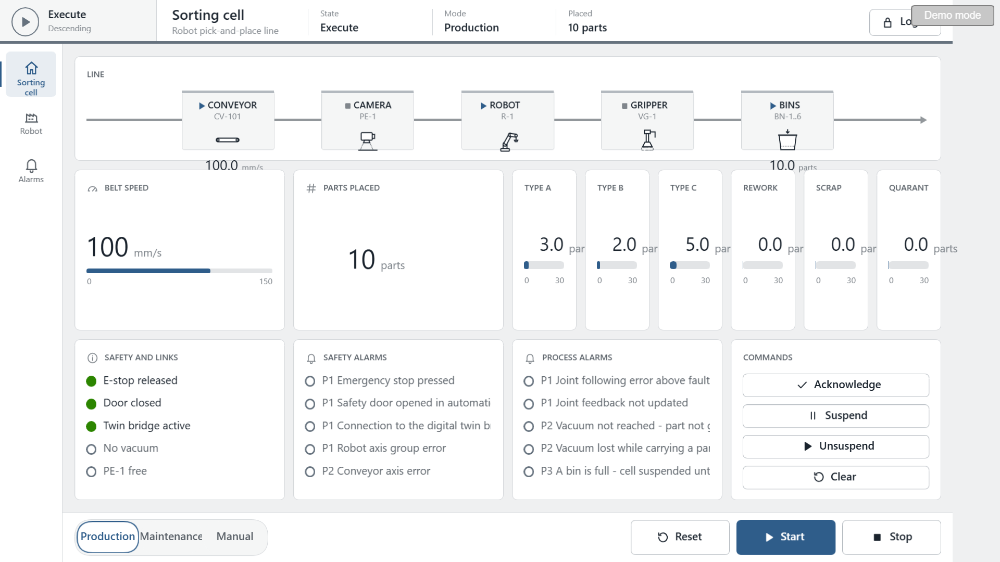
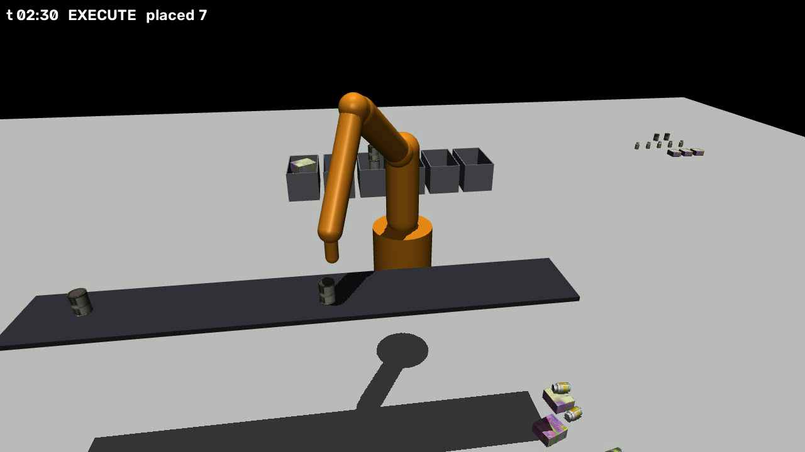
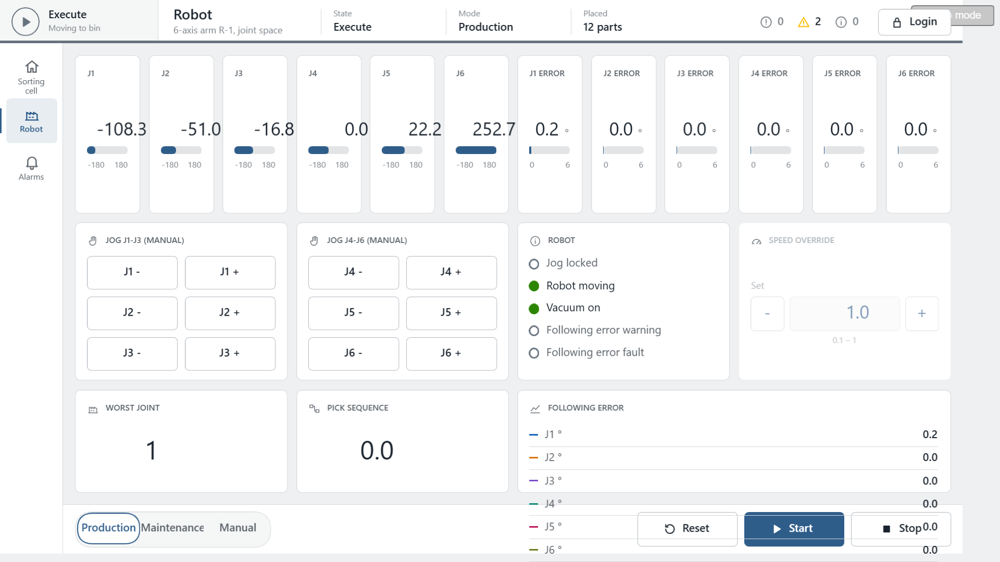

# codesys-ai-industrial-robot-control

Vision-guided 6-axis robot cell: CODESYS SoftMotion PLC, YOLOE perception, THX-02 decision layer, MuJoCo digital twin, ISA-101 HMI.

[](LICENSE)

A CODESYS soft-PLC (IEC 61131-3 Structured Text, PackML, SoftMotion) runs a robot cell that picks
three kinds of products from a moving belt and sorts them into bins. The cell is a MuJoCo digital
twin connected to the PLC over OPC UA; a camera in the twin and YOLOE (visual prompts, no
training) tell the PLC what each part is and where it lies. The operator works the cell from a
native CODESYS visualization.



| Digital twin (showcase camera) | Robot page |
|---|---|
|  |  |

**Live results** (soft-PLC + twin + camera/YOLOE, started from the HMI): 20-minute run, 87 parts
captured, 78 sorted, 0 wrong bin, 0 missed, 0 lost; bridge cycle 8 ms mean, longest gap 256 ms.
Vision benchmark (951 rendered parts): mAP@0.5 0.997, position error 2.0 mm mean.
PLC: 77 test cases in the CODESYS simulation (`tests/plc/`).

Design: [`docs/specs/2026-11-23-system-design.md`](docs/specs/2026-11-23-system-design.md);
architecture: [PLC](docs/architecture/plc.md), [twin and bridge](docs/architecture/twin-bridge.md),
[vision](docs/architecture/vision.md); decisions in [`docs/adr/`](docs/adr/).

## Quick start (Windows, CODESYS V3.5 SP22 Patch 4 installed)

```powershell
copy .env.example .env                    # test credentials for the local soft-PLC
python tools/uv_run.py airc plc start     # CODESYS Control Win as a console process
python tools/uv_run.py airc plc deploy    # headless download of the PLC project (~3 min)
python tools/uv_run.py --group vision airc vision export --prompts visual   # once
python tools/uv_run.py --group vision airc run --vision yoloe --viewer      # twin + camera + YOLOE
```

Then open the operator HMI at <http://127.0.0.1:8081/webvisu.htm> and press Reset, then Start.
`--vision oracle` uses the simulator's ground truth instead of the camera; `--record demo.mp4`
records a video. The full classroom demo is in [`docs/demo.md`](docs/demo.md).

The installer's inbound firewall rule for the runtime should be disabled so the soft-PLC is not
reachable from the network (see [ADR 0008](docs/adr/0008-softplc-runtime-and-opcua-security.md)).

Copyright (C) 2026 Avaz Asgarov. Licensed under the GNU Affero General Public License v3.0.
