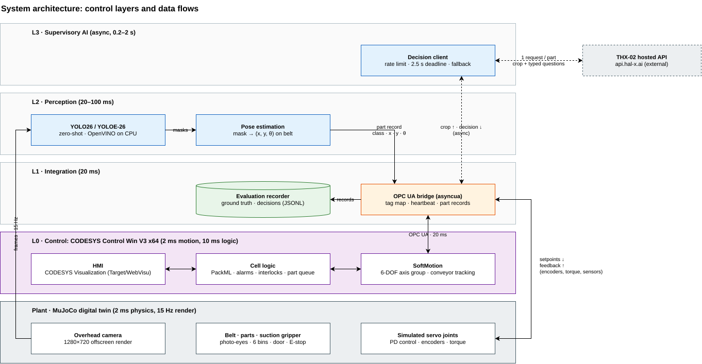

# Architecture

*Editable source: [`diagrams/system-layers.drawio`](diagrams/system-layers.drawio).*

## Layers

| Layer | Runs | Cycle | Responsibility |
|---|---|---|---|
| **L3 Supervisory AI** | Python decision client + THX-02 hosted API | async, 0.2–2 s | Quality disposition and identification check per part; alarm triage advice |
| **L2 Perception** | Python vision service | 20–100 ms | Zero-shot detection (YOLO26 / YOLOE-26, OpenVINO), pose (x, y, θ) on the belt |
| **L1 Integration** | Python OPC UA bridge | 20 ms | Tag exchange, heartbeat, part records, evaluation recording |
| **L0 Control** | CODESYS Control Win V3 x64 | 2 ms motion, 10 ms logic, 50 ms comm | PackML, SoftMotion axis group, conveyor tracking, alarms, interlocks, HMI |
| **Plant** | MuJoCo digital twin | 2 ms physics, 15 Hz render | Robot servo joints, belt, parts, suction gripper, sensors, camera |

**Rule:** a slower layer never blocks a faster one. The PLC never waits on vision or AI; a late
decision triggers the fallback policy.

## Who is master of what

| Quantity | Master | Followers |
|---|---|---|
| Joint setpoints, TCP pose, conveyor position | PLC (SoftMotion virtual drives) | Twin servo joints track them |
| Measured joint position, velocity, torque | Twin (simulated servos) | PLC supervises (following error, stall) |
| Physical object state | Twin | PLC learns via simulated sensors |
| Part identity, class, quality, destination | Vision + THX-02, written into the PLC part queue | PLC owns the record once written |

## Life of a part

1. The twin spawns a part upstream.
2. Photo-eye PE1 → the PLC latches the belt position, assigns a part id and requests a capture.
3. The vision service detects the part and computes its belt coordinates.
4. The bridge writes the record to the PLC and sends crop + metadata to THX-02 asynchronously.
5. THX-02 returns quality and identification reliability; the bridge writes them into the record.
6. The PLC selects the bin: quarantine (uncertain) → rework / scrap (defective) → type bin (good).
7. The robot tracks the belt, picks with suction and places the part; bin sensors confirm.

Details: [system design §4](../specs/2026-11-23-system-design.md) and the
[architecture decision records](../adr/).
